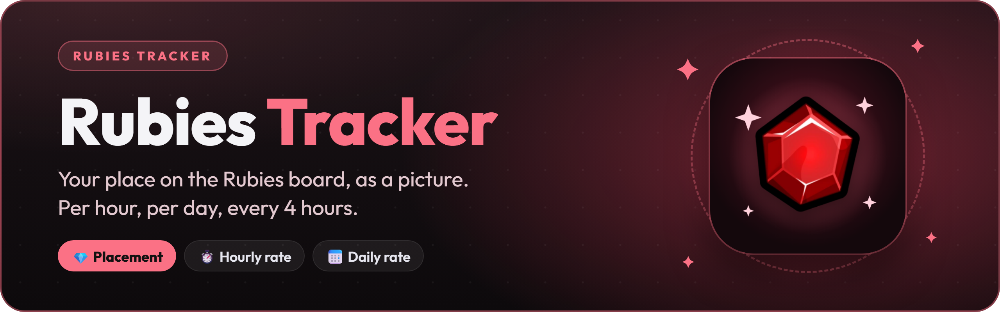

  

  <b>Keeps an eye on the <a href="https://petsuniverse.org/players">Pets Universe Rubies leaderboard</a> and sends one picture to Discord every 4 hours: 
  where I'm placed, how many rubies I made per hour, and what today brought in.</b>

  
  
  

---

## 🆕 What's new

| Date | Update |
|---|---|
| **27 Nov 2026** | 🤖 **Want your own?** Send the repo link to any AI chatbot and ask it to set it up: there's now a step-by-step guide written for it |
| **26 Nov 2026** | 📆 New **Per day** box: what you make in a full day at today's pace |
| **26 Nov 2026** | 🖼️ New banner, in the same style as the other trackers |
| **26 Nov 2026** | 💎 **Rubies Tracker is born**: your place, rubies per hour and today's total, as one picture every 4 hours |

## 💎 What the picture shows

- 🏅 **Your place** on the Rubies board, your total, and how many places you moved
- ⏱️ **Last 4 hours:** rubies made and your **rubies per hour**
- 📅 **Today:** rubies made since 00:00
- 📆 **Per day:** what you make in a day at today's pace (today's rubies per hour × 24)
- 📊 A small chart of your **rubies per hour** over the last 12 hours
- 👥 **Around you:** the players right above and below you, their speed, and when someone passes whom

## ⚙️ How it works

- Every hour it saves the Rubies board from the site's public API (no browser needed for the data).
- Every 4 hours (00, 04, 08, 12, 16, 20 Stockholm time) it draws the picture and posts it.
- History lives in `data/rubies.json` (the last 8 days), so rates survive restarts.
- Like its siblings, the job runs ~6 hours and then starts its own next run. No PC needed.
- Never guesses: if there isn't enough history yet, the picture says so.

## 🔧 Settings

In `.github/workflows/rubies.yml`:

| Setting | Default | Meaning |
|---|---|---|
| `TRACK_USER` | `imnotsadece` | the Roblox name to follow |
| `POST_EVERY_H` | `4` | post a picture every N hours |
| `RUBIES_BOARD` | `Rubies` | which board to read |

Secret: `DISCORD_WEBHOOK_URL` (*Settings → Secrets and variables → Actions*).
Test it any time: *Actions → tracker-runner → Run workflow → tick **preview***.

## 🤖 Want this for yourself? Ask an AI to set it up

You don't need to know how to code. Open any AI chatbot (ChatGPT, Claude, Gemini…), paste the link to this page and say:

> **"I want this set up for me. Please guide me step by step."**

The chatbot reads the guide below and walks you through it, one click at a time. It takes about 10 minutes, it's free, and you don't need a PC running: everything runs on GitHub.

### 📋 Setup guide for AI assistants

*This part is written for the AI chatbot helping someone set up their own copy. If you're a person, you can follow it too.*

**What this is:** a Pets Universe (Roblox) Rubies tracker. Every hour it saves the Rubies leaderboard from the site's public API. Every few hours it posts a picture to Discord with the user's place, rubies made in the last 4 hours, rubies per hour, today's total, the daily pace, and the players right around them. It runs for free on GitHub Actions in the user's own copy of this repo.

**Ask the user:**
1. **Their Roblox name** exactly as it shows on the Rubies board at https://petsuniverse.org/players. They need to be in the **top 50**, because that's all the site shares. This becomes `TRACK_USER`.
2. **How often** they want a picture: every 4 hours is the default; 1, 2, 3, 4, 6, 8, 12 or 24 all work. This becomes `POST_EVERY_H`.
3. **A Discord channel** where the pictures should go (they'll make a webhook for it).

**How to guide the user (they are usually not technical, often on a phone):**
- Go **one step at a time**. Give the exact button names and wait for them to confirm before moving on.
- Ask for the information in the "Ask the user" list first, then do the steps in order.
- **Never ask them to paste their Discord webhook URL into the chat.** It is a password: they paste it only into the GitHub secret box. If they already shared it somewhere public, have them delete the webhook and make a new one.
- They should **not edit any `.py` file**. Everything is set through secrets and the settings block in the workflow file.
- The repo must stay **public**. Public repos get unlimited free GitHub Actions minutes; this tracker runs 24/7 and would use up a private repo's free minutes in a couple of days. Secrets stay private in a public repo.

**Steps**
1. **GitHub account:** sign up free at https://github.com if they don't have one.
2. **Fork:** on this repo's page tap **Fork → Create fork**. Keep it public.
3. **Remove the original owner's history:** in the fork, open `data/rubies.json` → **⋯ → Delete file → Commit changes**.
4. **Webhook:** create one in the chosen Discord channel (see below) and copy it.
5. **Secret** (see below): add `DISCORD_WEBHOOK_URL` = the webhook URL. That's the only secret.
6. **Settings block:** edit `.github/workflows/rubies.yml`. Set `TRACK_USER` to their Roblox name and `POST_EVERY_H` to their choice. Leave `RUBIES_BOARD` as `"Rubies"`.

**Enable and start it**
- In the fork, open the **Actions** tab. GitHub disables workflows in forks, so click **"I understand my workflows, go ahead and enable them"**.
- Then go to **Actions → tracker-runner → Run workflow** (on a phone, use "Desktop site" in the browser if the button is missing).
- After that it runs by itself: each run lasts about 6 hours and then starts the next one, and a backup timer restarts it if it ever stops. Nothing to keep open.

**What they should see**
- To test right away: **Run workflow** with **preview** ticked. A picture appears in a few minutes. On the very first one the rate boxes show "…", because there's no history yet. That's expected: it never guesses.
- Then a picture at 00:00 and every `POST_EVERY_H` hours after (**Stockholm time**). Per-hour numbers appear after 1–2 hours and the full 4-hour window after 4 hours. "Today" only counts from when tracking started on the first day, and from 00:00 after that.

**If something's wrong**
- *"isn't in the top 50":* they're below #50, or `TRACK_USER` is misspelled.
- *Nothing at all:* open **Actions**, click the latest run, and read the error. Usually the secret name is misspelled or the webhook URL was cut off.
- *Times are Stockholm time.* To change it, edit the line `TZ = ZoneInfo("Europe/Stockholm")` in `rubies.py` and `runner.py`. That's the only code change worth making.

**Discord webhook (where the posts go)**
- Discord: right-click the channel (on a phone: long-press) → **Edit Channel → Integrations → Webhooks → New Webhook → Copy Webhook URL**. This needs "Manage Webhooks" permission on the server.
- Optional bot picture: in the same webhook screen, upload `assets/avatar.png` from this repo and give it a name.

**Adding a secret on GitHub**
- In the fork: **Settings → Secrets and variables → Actions → New repository secret**. The name must match exactly (capital letters, underscores).

**Editing the settings block**
- Open the workflow file on github.com, tap the **pencil icon**, change only the values between the quotes, then **Commit changes**.

---

Fan-made side project. Not affiliated with Pets Universe or Roblox. Shiny. 💎

