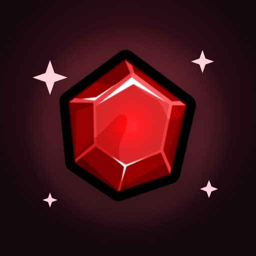

  

<h1 align="center">Rubies Tracker</h1>

  <b>Keeps an eye on the <a href="https://petsuniverse.org/players">Pets Universe Rubies leaderboard</a> and sends one picture to Discord every 4 hours: 
  where I'm placed, how many rubies I made per hour, and what today brought in.</b>

  
  
  

---

## 💎 What the picture shows

- 🏅 **Your place** on the Rubies board, your total, and how many places you moved
- ⏱️ **Last 4 hours:** rubies made and your **rubies per hour**
- 📅 **Today:** rubies made since 00:00 and your average per hour today
- 📊 A small chart of your **rubies per hour** over the last 12 hours
- 👥 **Around you:** the players right above and below you, their speed, and when someone passes whom

## ⚙️ How it works

- Every hour it saves the Rubies board from the site's public API (no browser needed for the data).
- Every 4 hours (00, 04, 08, 12, 16, 20 Stockholm time) it draws the picture and posts it.
- History lives in `data/rubies.json` (the last 8 days), so rates survive restarts.
- Like its siblings, the job runs ~6 hours and then starts its own next run. No PC needed.
- Never guesses: if there isn't enough history yet, the picture says so.

## 🔧 Settings

In `.github/workflows/rubies.yml`:

| Setting | Default | Meaning |
|---|---|---|
| `TRACK_USER` | `imnotsadece` | the Roblox name to follow |
| `POST_EVERY_H` | `4` | post a picture every N hours |
| `RUBIES_BOARD` | `Rubies` | which board to read |

Secret: `DISCORD_WEBHOOK_URL` (*Settings → Secrets and variables → Actions*).
Test it any time: *Actions → tracker-runner → Run workflow → tick **preview***.

---

Fan-made side project. Not affiliated with Pets Universe or Roblox. Shiny. 💎

